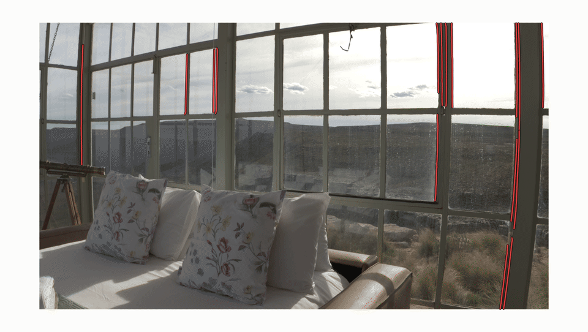
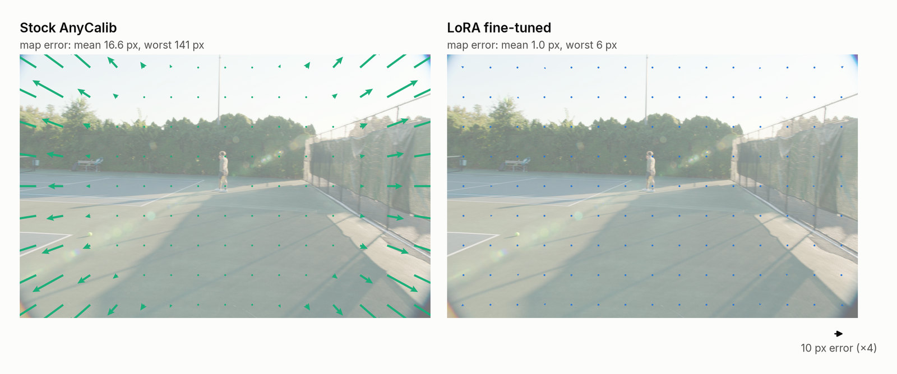
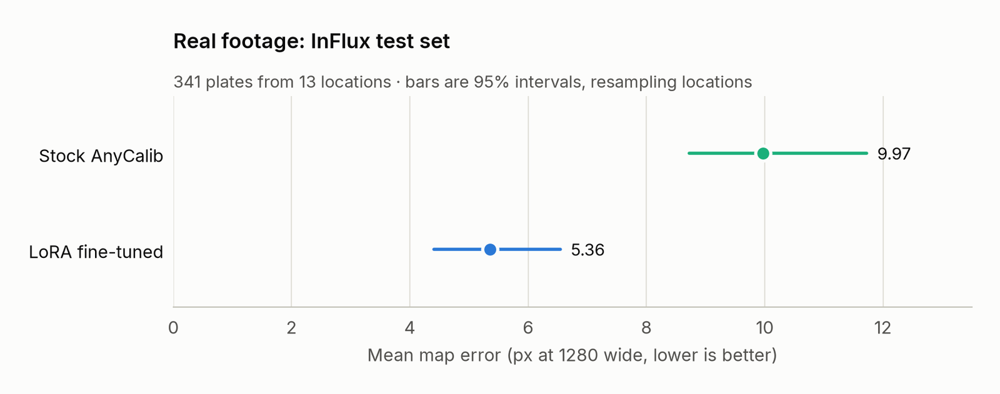

# AnyCalib for Nuke

A Nuke 17 node that estimates lens distortion from the plate, with no grid or camera move. It
runs [AnyCalib](https://github.com/javrtg/AnyCalib), fine-tuned on real footage and on renders
through Nuke's lens model, then refines the estimate so that straight edges in the plate come
out straight. [Write-up](https://www.andrewboyles.com/thoughts/anycalib-nuke).



It produces:

- `distortion1`, `distortion2` and `distortionCenter` in Foundry's NukeX Classic model, as
  CameraTracker solves them; LensDistortion2 takes them as `distortionDenominator0/1` and
  `centre`.
- Create LensDistortion buttons that build LensDistortion2 nodes from them.
- With `write STMaps` on, STMaps laid out as LensDistortion2 writes them: `forward.u/v`
  undistorts, `backward.u/v` redistorts. The bbox grows to include the overscan.
- `lens/*` metadata, which a Write (EXR, *all metadata*) puts in the header.
- A viewer overlay of the edges it used: green if the estimate straightens them, red if not.

## Install

Needs Nuke 17 on Linux. Unpack the plugin from the [release](../../releases) and download the
network from [Hugging Face](https://huggingface.co/mushyfruit/anycalib-nuke) into its `models`
folder:

```sh
tar xzf anycalib-nuke-*-nuke17-linux-plugin.tar.gz
curl -L -o anycalib/models/anycalib_dist.pt \
    https://huggingface.co/mushyfruit/anycalib-nuke/resolve/main/anycalib_dist.pt
```

Then add the `anycalib` folder to Nuke's plugin path, for example in `~/.nuke/init.py`:

```python
nuke.pluginAddPath('/path/to/anycalib')
```

The node is under Transform > AnyCalib. To build it yourself, see
[docs/DEVELOPMENT.md](docs/DEVELOPMENT.md).

## Use

1. Connect the plate, in the working space; the node converts it for the network.
2. To leave out moving objects, burn-ins or letterbox bars, connect a matte to the `mask` input
   and pick its channel in `mask`, as with CameraTracker. White is left out.
3. Press Analyze. It fits one lens to up to `max frames` frames spread over the input range (or
   a custom one), then `refine with lines` adjusts it to straighten long edges. `lock centre`
   keeps `distortionCenter` at 0.
4. Press Create LensDistortion, or turn on `write STMaps` and use an STMap: `uv = forward` to
   undistort, `uv = backward` to redistort CG rendered with the overscan in `overscan`.
5. Check the overlay: edges that should be straight should be green.

Analyze uses the active viewer's view, or the first view headlessly, so analyse stereo views
separately. A failed or cancelled run keeps the previous result.

On an RTX 3090 a frame takes about 70 ms, after 2 s to load the network. On the CPU it takes
about 1.4 s.

### Checks

On the Advanced tab:

- `frame variation`: how far the analysed frames disagree about the lens, in pixels. A large
  value means the lens changed over the range (zoom, focus); analyse those parts separately.
- `lines used`: edges that refined the estimate. Only long edges away from the centre count.
  Below 2, the network's estimate is kept.
- `line correction`: how far the lines moved the estimate, in pixels at the corners. If it's
  large on a plate full of curved architecture, compare with `refine with lines` off.

## Results

Undistort a grid of points with the estimate and with the calibrated lens, and measure how far
apart they land. On one of the better plates, with each arrow drawn 4× its length:



Averaged over 341 held-out plates of real cine footage from
[InFlux](https://influx.cs.princeton.edu/) (CC BY 4.0). Assuming no distortion at all scores
8.34 px.



## Limitations

- Spherical lenses only. Non-square pixels are handled through the format's pixel aspect, but
  anamorphic squeeze isn't estimated.
- On long lenses and good primes, assuming no distortion is often closer.
- No fisheyes: undistorting one to a flat image moves its corners thousands of pixels.
- One lens per analysed range: zooms and focus breathing need separate ranges.
